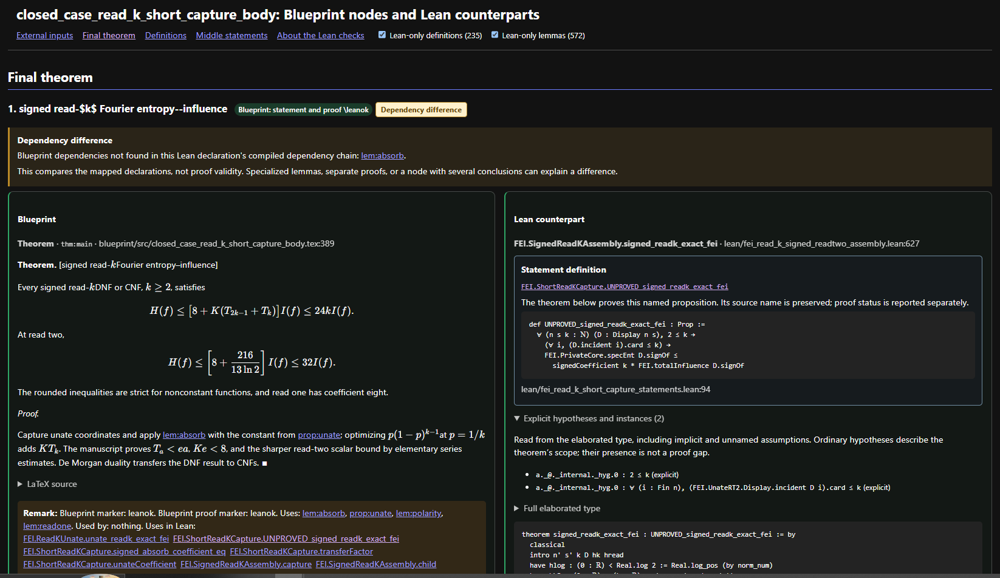

# lean-dump

**Every Blueprint statement beside its Lean proof, and what that proof rests on.**

A modern replacement for the standard Blueprint with its dependency graph:

- **Verifies much more**: proof axioms and `sorry`, conditional hypotheses,
  marker consistency, Blueprint ↔ Lean dependency agreement, audit freshness.
- **Displays much more**: typeset statement and proof beside the Lean source,
  named propositions unfolded, explicit hypotheses, Lean-only dependencies.

lean-dump turns a [leanblueprint](https://github.com/PatrickMassot/leanblueprint)
`.tex` into one HTML page. Each node's statement and proof sits beside the Lean
declaration that formalises it. The page shows which claims are proved
unconditionally, which rest on `sorry`, an axiom or an unproved hypothesis, and
where the Blueprint and Lean disagree.

### 📖 Documentation: <https://eyalk11.github.io/lean-dump/>

[How it works](https://eyalk11.github.io/lean-dump/#how) ·
[Features](https://eyalk11.github.io/lean-dump/#features) ·
[Verifications](https://eyalk11.github.io/lean-dump/#verifications) ·
[Usage](https://eyalk11.github.io/lean-dump/#usage) ·
[Setup](https://eyalk11.github.io/lean-dump/#setup) ·
[How to read a page](https://eyalk11.github.io/lean-dump/checks.html)



## Quick start

```bash
git submodule add https://github.com/eyalk11/lean-dump.git scripts/lean-dump
git submodule update --init --recursive
python scripts/lean-dump/dump_theorems_with_lean.py --blueprint blueprint/src/my_case.tex
```

The Lean audit the page reads is set up from [`templates/`](templates), as
described in [Setup](https://eyalk11.github.io/lean-dump/#setup). Two Claude
Code skills in [`.claude/skills/`](.claude/skills) guide an agent through
setup and generation.

## License

[MIT](LICENSE). `vendor/gh-tex-viewer` is a separate repository
([eyalk11/gh-tex-viewer](https://github.com/eyalk11/gh-tex-viewer)), not
covered by this license.
